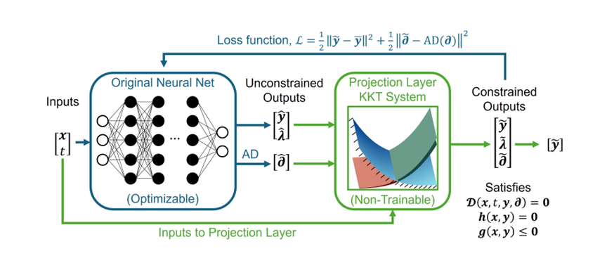

DAE-HardNet
===========

Neural modeling of differential–algebraic systems with hard constraints.

This guide describes version **2.0.0**. Start with the runnable example,
then use the guide and API reference for your own problem.

Quick overview
--------------

Declare coordinates, states, derivatives and residual equations such as

.. math::
   F(t,y,\dot y,p)=0,\qquad G(t,y,p)=0,\qquad H(t,y,p)\le 0.

DAEHN processes differential terms with a chosen discretization and supplies the
compiled problem to OHAGI and PURIN. ``DAETrainer`` trains the differential
model; ``DAEHardNet`` loads an exported inference model. The
:doc:`decay example <examples/quickstart>` explains each step. Projection enforces
the compiled constraints to solver tolerance; discretization error remains.

.. toctree::
   :maxdepth: 2
   :caption: Start here

   INSTALL
   examples/index
   user-guide/index

.. toctree::
   :maxdepth: 2
   :caption: Reference

   api/index
   ECOSYSTEM
   MIGRATION
   citations
   license
   contributing
   changelog
   BUILD
   PUBLISHING

Indices and search
------------------

* :ref:`genindex`
* :ref:`modindex`
* :ref:`search`
